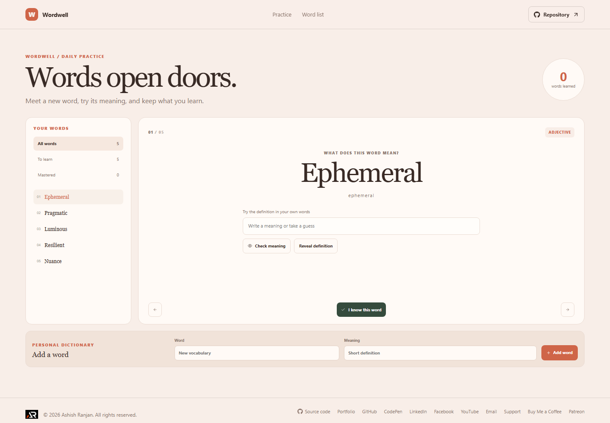

# Wordwell

Wordwell is a personal vocabulary practice tool for testing recall and collecting useful words.

Live site: https://a2rp.github.io/vocabulary-trainer/

## How to use it

Select a word from the list, enter a definition guess, and check it or reveal the meaning. Mark a word as known when you are ready, or add a word and definition to your own list.

## Features

- Curated vocabulary cards with part of speech and definition
- Filters for all words, words to learn, and mastered words
- Definition guess and reveal controls
- Self-assessed mastery tracking
- Add custom words and definitions

## Data and limits

Custom words and mastery selections are stored in this browser with localStorage.

Answer checking currently compares your guess with the stored definition text. The app does not sync or track review intervals.

## Run locally

Install Node.js, then run these commands from the project folder:

    npm install
    npm run dev

## Checks and deployment

    npm run lint
    npm run build
    npm run deploy

The deploy command builds the site and publishes the contents of dist to the gh-pages branch. The project is configured for GitHub Pages at https://a2rp.github.io/vocabulary-trainer/.

## Future improvements

These are ideas only and are not implemented yet:

- Accept several equivalent definitions (idea, not implemented)
- Schedule review sessions for difficult words (idea, not implemented)
- Group words into custom collections (idea, not implemented)

## Links

- Portfolio: [https://www.ashishranjan.net](https://www.ashishranjan.net)
- GitHub: [https://github.com/a2rp](https://github.com/a2rp)
- CodePen: [https://codepen.io/ash1198](https://codepen.io/ash1198)
- LinkedIn: [https://www.linkedin.com/in/aashishranjan](https://www.linkedin.com/in/aashishranjan)
- Facebook: [https://www.facebook.com/theash.ashish/](https://www.facebook.com/theash.ashish/)
- YouTube: [https://www.youtube.com/@ashishranjan-ashz?sub_confirmation=1](https://www.youtube.com/@ashishranjan-ashz?sub_confirmation=1)
- Email: [mailto:ash.ranjan09@gmail.com](mailto:ash.ranjan09@gmail.com)

## Support

- Support: [https://a2rp-donation-page.netlify.app/](https://a2rp-donation-page.netlify.app/)
- Buy Me a Coffee: [https://buymeacoffee.com/ashishranjan](https://buymeacoffee.com/ashishranjan)
- Patreon: [https://www.patreon.com/ashishranjan](https://www.patreon.com/ashishranjan)